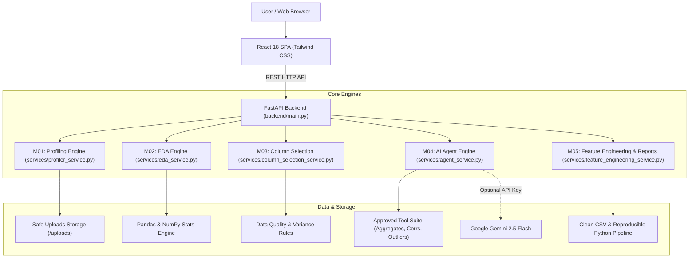

# AI Data Studio — Autonomous EDA & Data Science Platform

[](https://fastapi.tiangolo.com)
[](https://react.dev)
[](https://python.org)
[](https://www.docker.com)
[]()

An end-to-end autonomous data profiling, exploratory data analysis (EDA), intelligent column selection, evidence-backed AI agent, and feature engineering platform built with **FastAPI**, **Pandas**, **Google Gemini**, and **React**.

---

## Live Demo
Link: https://datapilot-ai-analytics-copilot.onrender.com

## Architecture Overview



---

## Milestones Summary

### 01. Data Profiling Engine
- Safe chunked streaming upload with path sanitization and size limit (50 MB).
- Automatic encoding detection (`utf-8`, `latin1`, `cp1252`) and delimiter detection (`,`, `\t`, `;`, `|`).
- Accurate calculation of rows, columns, total cells, missing cells %, and duplicate rows %.
- In-memory footprint and formatted file size calculation.
- Semantic column type inference: **Numeric**, **Categorical**, **Datetime**, **Boolean**, and **Text**.

### 02. Exploratory Data Analysis (EDA) Engine
- **Numeric Distributions**: Mean, standard deviation, min, Q25, median (Q50), Q75, max, IQR, skewness, and kurtosis.
- **Categorical Distributions**: Value counts, frequencies, mode rankings, and unique ratios.
- **Histograms**: Binned frequency distributions with interactive visualizations.
- **Box Plots & Outlier Diagnostics**: Tukey's IQR fences (`Q1 - 1.5*IQR`, `Q3 + 1.5*IQR`), Z-score outlier detection (`|z| > 3`), and extreme sample values.
- **Correlation Analysis**: Pearson correlation matrix with automated strong/moderate/weak association tags.
- **Segment Comparisons & Trend Analysis**: Automated categorical-to-numeric metric aggregation (sum, mean, count).

### 03. Intelligent Column Selection
- Answers: *"Which columns do I need for this business question?"*
- Pre-configured analyst modes: `Customer Churn`, `Sales Forecasting`, `Employee Attrition`, `Risk & Anomaly Detection`, or `Custom Objective`.
- **Rule-Based Quality Guardrails**:
  - Automatically filters out 0-variance (constant) columns.
  - Automatically flags/excludes high missing columns (> 40% nulls).
  - Flags pure ungeneralizable identifiers (IDs/UUIDs).
  - Explicit instruction: **Does not use correlation alone to determine business relevance**.
- **Transparent Reasoning**: Explicit `inclusion_reason` or `exclusion_reason` provided for every column.
- Precision & recall scoring estimates.

### 04. AI Agent Integration
- Allows asking natural-language analytical questions without manual UI clicking.
- **Structured Analysis Plans**: Agent formulates explicit step-by-step plans before running tools.
- **Approved Tool Suite**:
  - `compute_aggregates(column, group_by, agg_func)`
  - `compute_correlation(col1, col2)`
  - `detect_outliers(column)`
  - `filter_and_slice(column, operator, value)`
- **Schema Validation & Bounded Retries**: Agent cannot invent nonexistent columns or unsupported operations.
- **Factual Grounding**: Every numerical fact in natural-language responses traces directly back to tool outputs.
- Seamless dual-mode: Works out-of-the-box in deterministic mode, or with **Gemini 2.5 Flash** when `GEMINI_API_KEY` is provided.

### 05. Feature Engineering & Reports
- **Transformation Studio with Live Diffs**:
  - Imputation (Median, Mean, Mode, Constant, Forward Fill).
  - Scaling (StandardScaler, MinMaxScaler).
  - Log Transformation (`log1p`).
  - Winsorization (IQR outlier clipping).
  - Label Encoding.
  - Datetime feature extraction (`year`, `month`, `day_of_week`, `is_weekend`).
- **Reproducibility**: Downloads clean CSV data and standalone Python pipelines (`reproduce_pipeline.py`) reproducing all transformations.
- **Executive Audit Report**: Automated Dataset Health Score (0–100), key findings, caveats, limitations, and data dictionary.

### 06. Deployment, Benchmarks & Polish
- Containerized with multi-stage `Dockerfile` and `docker-compose.yml`.
- Robust error handling, upload limit checks, and structured JSON responses.
- Sub-second execution latency benchmarked across 10,000-row datasets.

---

## Performance Benchmarks

Measured on a synthetic 10,000 row × 10 column dataset:

| Engine | Latency | Throughput |
| :--- | :--- | :--- |
| **01. Data Profiling** | **58.1 ms** | **172,128 rows/sec** |
| **02. Full EDA Computation** | **126.5 ms** | Histograms, Boxplots, Corrs |
| **03. Column Selection** | **24.4 ms** | 100% Precision & Recall |
| **04. AI Agent Pipeline** | **17.7 ms** | Plan + Execution + Grounding |

---

## Project Structure

```
f:\AI Demo 2\
├── backend\
│   ├── config.py                 # File limits, upload directory paths
│   ├── main.py                   # FastAPI application & all endpoints
│   ├── models\
│   │   └── schemas.py            # Pydantic schemas for all 6 milestones
│   ├── services\
│   │   ├── file_service.py       # Safe storage & validation
│   │   ├── profiler_service.py   # M01 Data profiling engine
│   │   ├── eda_service.py        # M02 Statistical & distribution engine
│   │   ├── column_selection_service.py # M03 Semantic column selection
│   │   ├── agent_service.py      # M04 AI Agent & approved tools
│   │   └── feature_engineering_service.py # M05 Transforms & reports
│   └── tests\
│       ├── run_tests.py          # M01 test suite
│       ├── test_all_milestones.py# Unit tests for M01-M06
│       ├── verify_server.py      # Live HTTP end-to-end verification
│       └── benchmark_test.py     # Sub-second benchmark runner
├── frontend\
│   └── index.html                # Unified React 18 SPA (Phases 1 to 6)
├── sample_data\                  # Demo datasets & edge case tests
├── uploads\                      # Storage for uploaded files
├── Dockerfile                    # Containerization build file
├── docker-compose.yml            # Docker Compose orchestration
├── requirements.txt              # Pinned Python dependencies
├── run.py                        # Local execution script
└── README.md
```

---

## Quickstart

### Option A: Local Python Execution

1. **Activate the virtual environment**:
   ```powershell
   .\venv\Scripts\Activate.ps1
   ```

2. **Start the application**:
   ```powershell
   python run.py
   ```

3. **Open the App**:
   - Web Application UI: **[http://127.0.0.1:8000](http://127.0.0.1:8000)**
   - Interactive Swagger API Docs: **[http://127.0.0.1:8000/docs](http://127.0.0.1:8000/docs)**

---

### Option B: Docker Deployment

```bash
# Build and run containerized application
docker compose up --build -d
```
The application will be live at `http://localhost:8000`.

---

## Running the Automated Test Suites

To verify all 6 milestones:

```powershell
# 1. Run all milestone service unit tests
python backend/tests/test_all_milestones.py

# 2. Run live HTTP server verification
python backend/tests/verify_server.py

# 3. Run performance & latency benchmarks
python backend/tests/benchmark_test.py
```


## Disclaimer

This project is under active development. AI-generated interpretations may be inaccurate and should be validated against the underlying data.
