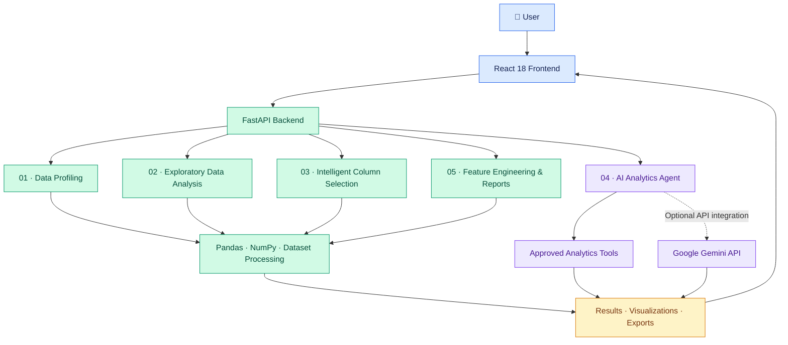

# 🚀 AI Data Studio — Autonomous EDA & Data Science Platform
<h1 align="center">AI Data Studio</h1>

<h3 align="center">
  Autonomous EDA & Data Science Platform
</h3>

<p align="center">
  Turn raw datasets into meaningful insights with AI-assisted analytics.
</p>

<p align="center">
  <a href="https://datapilot-ai-analytics-copilot.onrender.com/">
    
  </a>
  <a href="https://github.com/Bikash07-git/DataPilot-AI-Analytics-Copilot">
    
  </a>
</p>

<p align="center">
  
  
  
  
  
  
  
</p>

---

## 📌 Overview

**AI Data Studio** is an AI-assisted data analytics platform designed to simplify dataset exploration and accelerate the data science workflow.

Built with **Python, FastAPI, Pandas, React, and Google Gemini**, the platform brings together data profiling, exploratory data analysis (EDA), intelligent column selection, natural-language analytical queries, and feature engineering in a unified application.

The goal is to help analysts spend less time on repetitive data preparation and more time understanding their data.

### ✨ What can it do?

| Capability                      | Description                                                                                   |
| ------------------------------- | --------------------------------------------------------------------------------------------- |
| 📂 Data Profiling               | Inspect dataset structure, dimensions, missing values, duplicates, and inferred column types. |
| 📊 Exploratory Data Analysis    | Explore descriptive statistics, distributions, outliers, and correlations.                    |
| 🎯 Intelligent Column Selection | Identify potentially useful features based on an analytical objective and data-quality rules. |
| 🤖 AI Analytics Agent           | Ask analytical questions in natural language and execute supported analysis tools.            |
| 🛠️ Feature Engineering         | Apply transformations such as imputation, scaling, encoding, and datetime extraction.         |
| 📑 Reports & Exports            | Generate dataset health summaries and export transformed data and reproducible pipelines.     |

---

## 🌐 Live Application

**Try it here:** [AI Data Studio — Live Demo](https://datapilot-ai-analytics-copilot.onrender.com/)

> **Note:** The hosted application uses a free deployment tier. It may take some time to respond after a period of inactivity. Uploaded files may not persist across restarts or redeployments.

---

## 🏗️ System Architecture



### 🔄 How the workflow operates

1. **Upload:** The user submits a dataset through the web interface.
2. **Profile:** The backend inspects its structure and data quality.
3. **Analyze:** Statistical summaries and exploratory diagnostics are calculated.
4. **Select:** Column-selection rules help identify relevant features.
5. **Ask:** The analytics agent interprets supported questions and invokes approved tools.
6. **Transform:** The user can apply supported feature-engineering operations and export results.

---

## 🧩 Six Development Milestones

| Milestone | Engine                     | Key capabilities                                                                                      |
| :-------: | -------------------------- | ----------------------------------------------------------------------------------------------------- |
|     01    | 📂 Data Profiling          | File validation, encoding and delimiter detection, missing values, duplicates, semantic types         |
|     02    | 📊 EDA Engine              | Descriptive statistics, distributions, histograms, box plots, outlier detection, correlation analysis |
|     03    | 🎯 Column Selection        | Business objectives, constant-column filtering, missing-value checks, identifier detection, reasoning |
|     04    | 🤖 AI Agent                | Natural-language queries, structured plans, approved tools, schema validation, grounded results       |
|     05    | 🛠️ Feature Engineering    | Imputation, scaling, log transforms, winsorization, label encoding, datetime features, reports        |
|     06    | 🚢 Deployment & Validation | Docker, API error handling, automated tests, performance checks, deployment configuration             |

---

## 🔬 Feature Deep Dive

### 01 · Data Profiling Engine

- Chunked file upload with validation, path sanitization, and a configured 50 MB limit.
- Support for common text encodings and delimiters.
- Dataset dimensions, total cells, missing values, duplicate rows, and file-size information.
- Semantic type inference for numeric, categorical, datetime, Boolean, and text columns.

### 02 · Exploratory Data Analysis

**Numeric analysis**

- Mean, standard deviation, minimum, quartiles, median, maximum, IQR, skewness, and kurtosis.
- Histogram distributions and box-plot diagnostics.
- IQR-fence and Z-score-based outlier detection.

**Categorical analysis**

- Value counts, frequencies, mode rankings, and unique-value ratios.

**Relationships**

- Pearson correlation analysis with association-strength labels.
- Grouped metrics and comparisons across categorical segments.
- Trend analysis where supported by the available data and implementation.

### 03 · Intelligent Column Selection

Helps answer: *“Which columns should I use for this analytical objective?”*

- Analyst modes for customer churn, sales forecasting, employee attrition, risk and anomaly detection, and custom objectives.
- Flags constant columns, high-missingness columns, and potential identifiers.
- Provides inclusion and exclusion reasoning for columns.
- Avoids treating correlation as the sole measure of business relevance.

### 04 · AI Analytics Agent

Ask questions about a dataset in natural language.

Example questions:

```text
What is the average salary by department?

Which department has the highest average salary?

How many records are in each category?

Which numerical columns are strongly correlated?

Identify potential outliers in the salary column.
```

The agent is designed to use supported analytical tools, including:

- `compute_aggregates(column, group_by, agg_func)`
- `compute_correlation(col1, col2)`
- `detect_outliers(column)`
- `filter_and_slice(column, operator, value)`

Additional design goals include structured analysis plans, column validation, bounded retries, and grounding numerical answers in computed results.

**AI configuration:** The application can operate in deterministic mode, with Gemini integration enabled when `GEMINI_API_KEY` is configured. AI-generated explanations should always be checked against the underlying data.

### 05 · Feature Engineering & Reports

Supported transformations include:

- Missing-value imputation: mean, median, mode, constant, and forward fill.
- Feature scaling: standardization and Min-Max scaling.
- Log transformation using `log1p`.
- Outlier clipping through winsorization-style IQR limits.
- Label encoding.
- Datetime features such as year, month, day of week, and weekend indicators.

The reporting workflow is designed to support cleaned-data exports, reproducible Python pipelines, dataset health summaries, data dictionaries, findings, and limitations.

### 06 · Deployment & Validation

- Docker-based application packaging.
- Docker Compose configuration.
- FastAPI endpoints and interactive API documentation.
- Automated testing and benchmark scripts.
- Error handling and upload validation.

---

## ⚡ Performance Benchmarks

The original project benchmarks report the following measurements for a synthetic dataset of **10,000 rows × 10 columns**.

| Operation            | Reported latency | Reported throughput / output        |
| -------------------- | ---------------: | ----------------------------------- |
| Data profiling       |          58.1 ms | 172,128 rows/sec                    |
| Full EDA computation |         126.5 ms | Histograms, box plots, correlations |
| Column selection     |          24.4 ms | Reported precision and recall: 100% |
| AI agent pipeline    |          17.7 ms | Plan, execution, and grounding      |

> **Benchmark note:** These are project-reported measurements, not independently verified production guarantees. Results can vary with hardware, dataset characteristics, warm-up, and measurement methodology. The AI agent timing should be interpreted separately from external Gemini API latency when that API is used.

---

## 🗂️ Project Structure

```text
AI-Data-Studio/
├── backend/
│   ├── config.py
│   ├── main.py
│   ├── models/
│   │   └── schemas.py
│   ├── services/
│   │   ├── file_service.py
│   │   ├── profiler_service.py
│   │   ├── eda_service.py
│   │   ├── column_selection_service.py
│   │   ├── agent_service.py
│   │   └── feature_engineering_service.py
│   └── tests/
│       ├── run_tests.py
│       ├── test_all_milestones.py
│       ├── verify_server.py
│       └── benchmark_test.py
├── frontend/
│   └── index.html
├── sample_data/
├── uploads/
├── Dockerfile
├── docker-compose.yml
├── requirements.txt
├── run.py
└── README.md
```

> The tree above reflects the structure provided for this project. Some folders, scripts, or filenames may differ in the current repository. Update the tree to match the actual checked-in files.

---

## 🚀 Getting Started

### Prerequisites

- Python version compatible with the project's dependencies.
- Git.
- Docker Desktop, if using the Docker option.
- A Gemini API key only if you want to enable Gemini-powered features.

### Option A · Run Locally with Python

**1. Clone the repository**

```bash
git clone https://github.com/Bikash07-git/DataPilot-AI-Analytics-Copilot.git
cd DataPilot-AI-Analytics-Copilot
```

**2. Create a virtual environment**

Windows PowerShell:

```powershell
python -m venv .venv
.\.venv\Scripts\Activate.ps1
```

**3. Install dependencies**

```bash
python -m pip install -r requirements.txt
```

**4. Configure the environment**

Set your API key in the local environment if Gemini integration is needed. Do not commit secrets to GitHub.

PowerShell for the current terminal session:

```powershell
$env:GEMINI_API_KEY = "YOUR_GEMINI_API_KEY"
```

**5. Start the application**

```bash
python run.py
```

Open the application:

- Web interface: [http://127.0.0.1:8000](http://127.0.0.1:8000)
- Interactive API documentation: [http://127.0.0.1:8000/docs](http://127.0.0.1:8000/docs)

If the application uses a different local port, follow the startup output and project configuration.

### Option B · Run with Docker

Build and start the application:

```bash
docker compose up --build -d
```

Open [http://localhost:8000](http://localhost:8000).

Stop the containers:

```bash
docker compose down
```

---

## 🧪 Testing

Run the main pytest suite:

```bash
python -m pytest backend/tests -q
```

The repository also includes additional scripts for milestone testing, server verification, and benchmarks:

```bash
python backend/tests/test_all_milestones.py
python backend/tests/verify_server.py
python backend/tests/benchmark_test.py
```

Run a script only if it exists in your checked-out version. For repeatable results, record the Python version, dependencies, dataset dimensions, and execution environment.

---

## 🔐 Security & Data Handling

- Keep `GEMINI_API_KEY` and other credentials out of source control.
- Use `.env.example` for placeholder configuration rather than real secrets.
- Validate uploaded files and enforce configured size limits.
- Avoid uploading confidential, personal, or regulated data to an unapproved environment.
- Review how datasets are stored, processed, and sent to external AI services before using sensitive information.
- Treat generated insights as analytical assistance, not guaranteed facts.

---

## 🛣️ Roadmap

- [ ] Improve natural-language column and aggregation selection.
- [ ] Expand regression tests for analytical queries and edge cases.
- [ ] Add CI checks for tests and code quality.
- [ ] Add representative application screenshots and example workflows.
- [ ] Improve deployment persistence and operational monitoring.
- [ ] Document benchmark methodology and reproducible results.

---

## 🖼️ Application Screenshots

Add screenshots of the running application to a `docs/screenshots/` directory, then display them here.

For example, after adding the actual files:

```markdown


```

Use genuine screenshots of the current application rather than mockups.

---

## 👨‍💻 Author

**Bikash Sagar Koiri**

- GitHub: [@Bikash07-git](https://github.com/Bikash07-git)
- LinkedIn: [bikashsk26](https://www.linkedin.com/in/bikashsk26)

---

## ⚠️ Disclaimer

AI Data Studio is an actively developed portfolio project. Analytical outputs depend on dataset quality, supported operations, and implementation details. Validate important results independently before using them for business or operational decisions.

\<p align="center">
&#x20; \<strong>Built to make data exploration more accessible, reproducible, and insightful.\</strong>
\</p>
